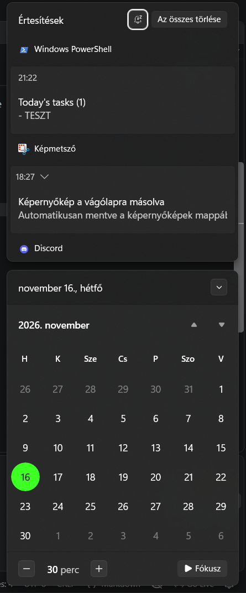
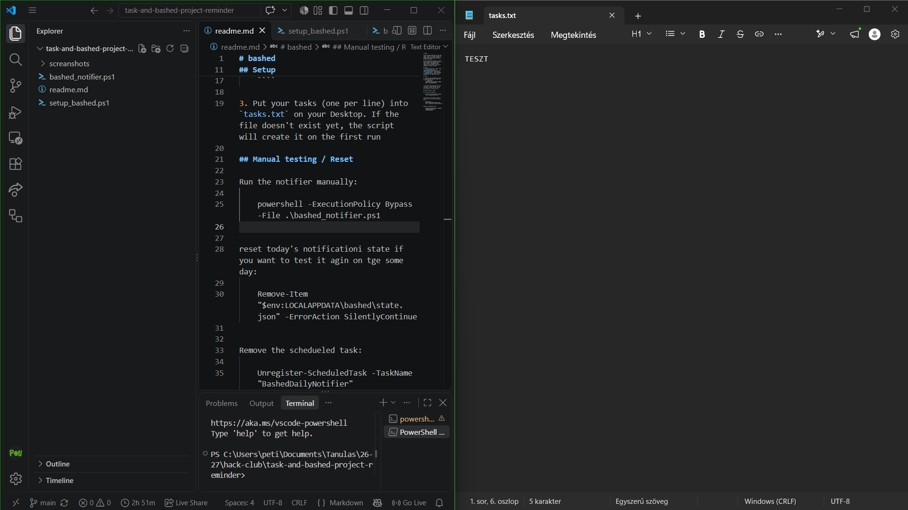
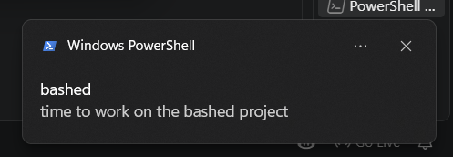
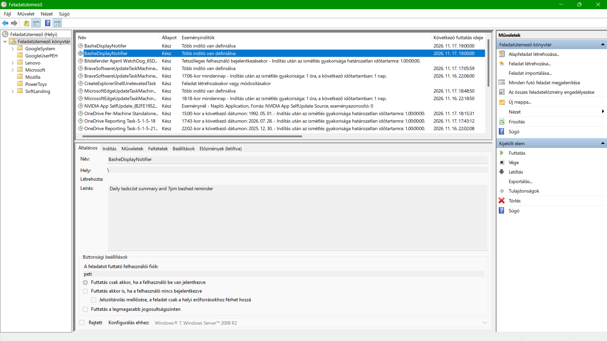

# bashed

A small windows Powershell script that reads 'tasks.txt' from my desktop when I boot up my pc and sends a native Windows toaat notification whith what I need to do today.

It also reminds me every day at 7pm to keep working on the bashed project- If I don't tudn on my computer until after 19:00, it sendds the task summary first and eaits 5 min before sending the project reminder.

## Files
- `bashed_notifier.ps1` - reads `tasks.txt`, tracks daily state in `%LOCALDATA%\bashed\state.json`, and pushes windows toast notifications
- `setup_bashed.ps1` - adds a Windows Task Sceduler job so the script runs automatically at logon and at 7pm

## Setup

1. Clone the repo somewhere on your pc
2. open Powershell in the folder and run the setup script:
    ````powershell
    powershell -ExecutionPolicy Bypass -File .\setup_bashed.ps1
    ````

3. Put your tasks (one per line) into `tasks.txt` on your Desktop. If the file doesn't exist yet, the script will create it on the first run

## Manual testing / Reset

Run the notifier manually:

    powershell -ExecutionPolicy Bypass -File .\bashed_notifier.ps1


reset today's notificationi state if you want to test it agin on tge some day:

    Remove-Item "$env:LOCALAPPDATA\bashed\state.json" -ErrorAction SilentlyContinue


Remove the schedueled task:

    Unregister-ScheduledTask -TaskName "BashedDailyNotifier" -Confirem:$false


## Screenshots

*Notification*


*tasks.txt*


*Bashed Reminder*


*Task Scheduler*
